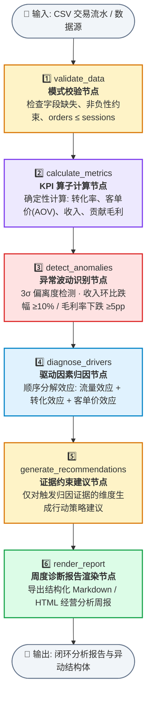

# Business Analysis Agent / 经营分析 Agent

<p align="center">
  <strong>基于 LangGraph 的确定性业务经营分析与异动归因工作流引擎</strong><br>
  <em>Deterministic StateGraph · Strict Evidence Binding · Zero-Hallucination Guardrails</em>
</p>

<p align="center">
  <a href="https://github.com/zhangpelf/business-analysis-agent"></a>
  <a href="https://github.com/zhangpelf/business-analysis-agent"></a>
  <a href="https://github.com/zhangpelf/business-analysis-agent"></a>
  <a href="https://github.com/zhangpelf/business-analysis-agent"></a>
</p>

---

## 📌 项目定位与核心设计哲学

`business-analysis-agent` 将实际经营分析与商业中台实战中积累的核心问题，转化为一个**高可靠、可离线复现、严格受证据约束**的 AI 应用工程项目：

1. **拒绝把大模型当计算器**：核心 KPI 算子、同环比变动、3σ 异常波动识别与收入驱动因素分解，**100% 由纯 Python 确定性代码执行**，不交给大模型计算。
2. **证据链强约束 (Evidence-Constrained)**：每一条建议必须严格挂钩到底层的结构化数据证据（如 `revenue_impact` 差分值），杜绝“看似合理但没有数据来源”的模型幻觉。
3. **离线高可用与双模式执行**：默认离线运行，内置合成数据 `demo_metrics.csv`；即使不配置任何 API Key，也能完整跑通诊断闭环。
4. **上下游生态协同**：
   - **上游方法论注入**：遵循 [`transaction-ops-skill`](https://github.com/zhangpelf/transaction-ops-skill) 的漏斗转化与量利归因模型；
   - **下游策略落地**：异动归因结果可无缝对接 [`prd-writer-skill`](https://github.com/zhangpelf/prd-writer-skill)，联动 n8n 触发企微/飞书战报闭环。

---

## 🔄 核心 LangGraph 诊断工作流 (StateGraph Architecture)

工作流严格由 6 个显式状态节点构成，状态数据在 `AnalysisState` (TypedDict) 中单向有序传递：



---

### 各节点契约与数据流转说明

| 步骤 | 节点名称 | 输入状态字段 | 核心算子与逻辑 | 输出状态字段 |
| :--- | :--- | :--- | :--- | :--- |
| **01** | `validate_data` | `raw_data` (DataFrame) | 校验必选字段；断言 `orders <= sessions`；排查零或负值；保证每期有效 | `validated_data` |
| **02** | `calculate_metrics` | `validated_data` | 计算转化率 $CR = \frac{Orders}{Sessions}$；客单价 $AOV = \frac{Rev}{Orders}$；贡献毛利 $CM = Rev - VC - MC$ | `metrics` |
| **03** | `detect_anomalies` | `metrics` | 扫描各周期同环比变动，标记达到预警线的异动指标（如收入环比跌幅 $\ge 10\%$） | `anomalies` |
| **04** | `diagnose_drivers` | `metrics` | 采用对数/差分因子分解法：$\Delta \text{Revenue} = f(\Delta Sessions) + f(\Delta CR) + f(\Delta AOV)$ | `evidence` |
| **05** | `generate_recommendations` | `evidence` | 严格基于 `evidence` 中的负向驱动因子匹配策略干预规则，无证据不产出建议 | `recommendations` |
| **06** | `render_report` | `metrics`, `anomalies`, `evidence`, `recommendations` | 组装四段式标准分析周报，包含 KPI 看板、异动警报、穿透归因表与管理建议 | `report_markdown` |

---

## 📊 数学与归因算子公式

### 1. 收入三动因差分分解
大盘收入由流量、转化与客单价三者相乘得出：
$$\text{Revenue} = \text{Sessions} \times \text{Conversion Rate} \times \text{AOV}$$

对同一周期的异动，系统计算三项结构化 `revenue_impact`：
$$\Delta \text{Rev} = \text{Impact}_{\text{sessions}} + \text{Impact}_{\text{CR}} + \text{Impact}_{\text{AOV}}$$
三项影响金额之和精确等于大盘相对上一期的收入变化量，支持单据级独立复算。

### 2. 贡献毛利与健康度
$$\text{Contribution Margin} = \text{Revenue} - \text{Variable Cost} - \text{Marketing Cost}$$
$$\text{Margin Rate} = \frac{\text{Contribution Margin}}{\text{Revenue}}$$

---

## 🛠️ 本地快速开始

```bash
# 1. 创建并激活虚拟环境
python3 -m venv .venv
source .venv/bin/activate

# 2. 安装本地开发包与依赖
pip install -e '.[dev]'

# 3. 运行交互式 Streamlit 界面
streamlit run app.py --server.address 127.0.0.1

# 4. 运行 FastAPI 服务
uvicorn business_analysis_agent.api:app --host 127.0.0.1 --reload

# 5. 执行全量单元测试 (Pytest)
pytest
```

### Docker 一键部署

```bash
docker build -t business-analysis-agent .
docker run --rm -p 127.0.0.1:8501:8501 business-analysis-agent
```

---

## 🛡️ 数据安全与使用声明

- **零敏感数据**：内置 `demo_metrics.csv` 均为程序生成的合成测试数据，特意包含可识别的收入与毛利恶化情形，不含任何特定企业生产数据；
- **安全沙箱**：默认纯本地计算，不发送任何外部网络请求；若显式开启 LLM 辅助摘要，系统会拦截任何带未经验证数字的输出，确保确定性代码是唯一数值来源。
